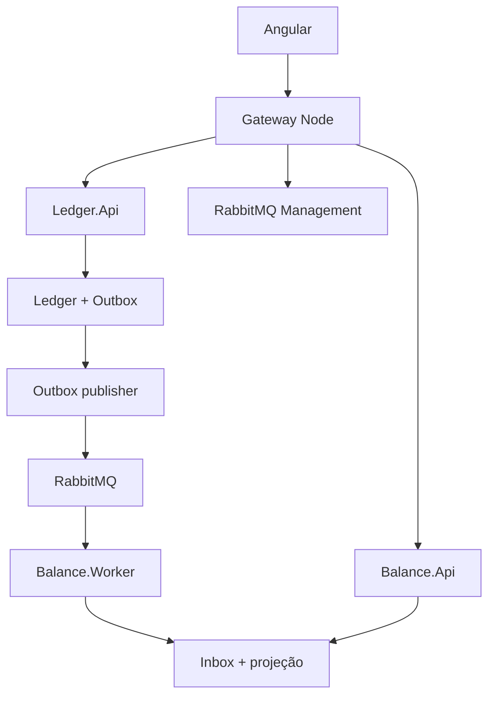

# Decisões do frontend

## Fronteiras

O gateway só encaminha endpoints conhecidos e lê métricas agregadas. Não possui acesso ao banco nem ao Docker. Validação JWT, autorização por conta, saldo, concorrência, idempotência e estorno continuam nas APIs .NET. A consulta de métricas primeiro valida o Bearer em `/api/v1/clientes/me/saldo`; portanto a senha de gerenciamento não representa autenticação do usuário final. Como a fila é global, esse monitor deve ficar no ambiente de demonstração local. Uma versão multicliente precisa de policy operacional própria e autorização apropriada.

## Idempotência na experiência

Uma nova intenção recebe `crypto.randomUUID()`. Caminho, chave e corpo bruto são imutáveis quando a resposta é incerta. O botão de reenvio preserva os três. Um novo formulário gera outra intenção; HTTP 422 não é corrigido silenciosamente trocando chave. Resultado original concluído retorna 201, nunca muda para 200 por suposição do frontend. A retenção do backend é 48 horas; reenvio depois da expiração requer reconciliação, não repetição cega.

Intenções ficam na memória da aba. Não há persistência de tokens ou corpos em Web Storage. O benefício é minimizar exposição local; o custo é exigir reconexão e reconciliação manual de uma resposta perdida após recarregar a aba. O frontend não é trilha de auditoria.

## Dinheiro

Entrada textual → validação estrita → unidades inteiras BigInt → literal decimal no JSON. Leitura HTTP como texto → preservação do token `amount` → formatação pt-BR sem ponto flutuante. `lastSequence`, paginação e contadores são números JS porque não são valores monetários. O backend continua responsável pelo domínio e pelo limite agregado de saldo.

## Projeção e observabilidade

O frontend nunca aumenta/subtrai saldo antes de ler a projeção. Um lançamento confirmado pode demorar para aparecer; sequências ordenadas permitem acompanhar a incorporação. Não se infere que um evento específico está no RabbitMQ por métricas globais. Não se inspeciona Outbox/inbox via banco. O fluxo visual informa a garantia de commit do backend e as evidências que realmente possui.

Polling de cinco segundos não sobrepõe uma atualização anterior, e respostas de uma conta antiga são descartadas ao mudar de conta. Falhas são exibidas, mantendo a última leitura com aviso de possível defasagem. Contadores indisponíveis não são apresentados como zero. Zero consumidores push é esperado no worker que usa BasicGet.

## Segurança e implantação

O browser usa mesma origem. O gateway expõe somente rotas permitidas, não segue redirects, limita requisições a 64 KiB e aplica timeout. Não faz retry de mutações. A resposta original e headers relevantes são preservados. Segredos são variáveis server-side e não há dependências Node de runtime. A imagem final contém apenas compilação e gateway, roda com usuário node, somente leitura e sem socket Docker. HTTPS e identidade operacional segregada são necessários fora do ambiente local.

A compilação Angular desativa `inlineCritical` para evitar o handler inline de carregamento de stylesheet que seria bloqueado pelo CSP. Os modais têm foco inicial, retorno ao acionador, contenção de Tab e Escape. O CSS respeita preferência de movimento reduzido.
